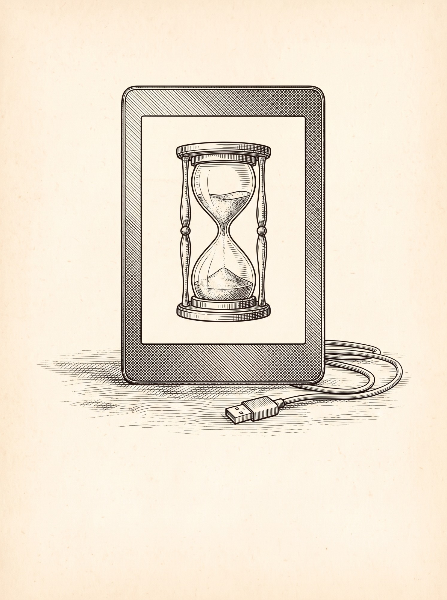
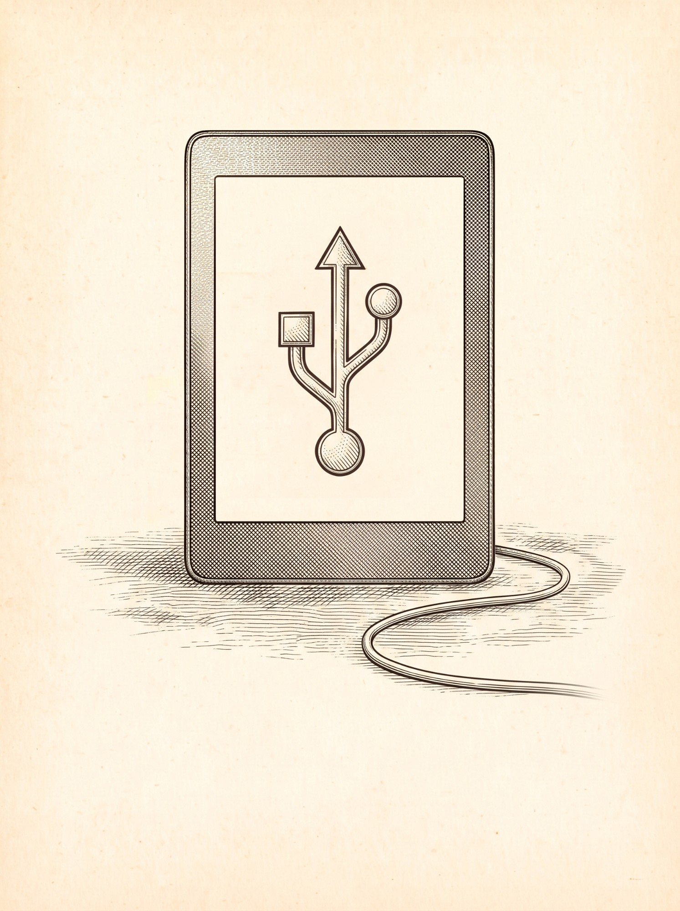
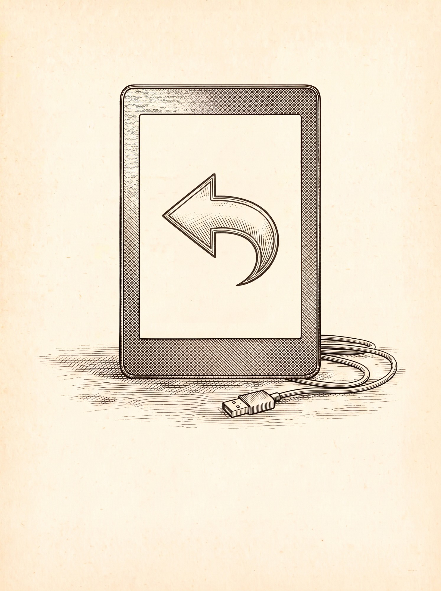

# USB storage for KOReader on Kindle

`usbms.koplugin` brings USB mass storage to [KOReader](https://koreader.rocks) on jailbroken Kindles. Tap **Start USB storage** (or accept the prompt when you plug in a computer) to share the Kindle's storage without manually leaving KOReader. With the direct method, KOReader restarts after eject or unplug once storage recovery succeeds. The alternative Amazon UI method can return to KOReader after the cable is unplugged, if automatic return is enabled.

Without it, KOReader on Kindle blocks USB storage on purpose (it lives on the partition that would be exported), so copying books means leaving KOReader and going through the Amazon UI.

| Waiting for a computer | Drive exported | Returning |
| :-: | :-: | :-: |
|  |  |  |

## Compatibility

| | |
| :-- | :-- |
| Tested on | Kindle Paperwhite 2 (6th gen, 2013), firmware 5.12.2.2, KOReader 2026.07.2 started with `koreader.sh --framework_stop` |
| Other Kindles | Untested. The direct method checks the expected storage layout and services before export (see [Safety](#safety)) and refuses if a check fails. Passing those checks does not establish compatibility with an untested device. The Amazon UI method uses Amazon's USB handling, but is also untested elsewhere |
| Status screens | Illustrations tested on Paperwhite 2: 758x1024 visible pixels, 8-bit framebuffer with 768-byte rows. Other framebuffer formats use a text fallback |
| Other platforms | Unsupported. The plugin disables itself on anything but a Kindle |

## Install

You need a jailbroken Kindle with KOReader already installed. Back up your books and other userstore data before trying the plugin on an untested setup.

1. Download `usbms.koplugin-vX.Y.Z.zip` from [Releases](../../releases).
2. Connect the Kindle (leave KOReader first) and unzip into `koreader/plugins/`, so you get `koreader/plugins/usbms.koplugin/main.lua`.
3. Eject, start KOReader, and check *Tools → More tools → Plugin management → USB mode (Kindle)* is enabled.

The first release is version **1.0.0**. Until a release ZIP is published, you can [build the package from source](#build-a-release). The development tools are not required to install or run a packaged release.

## Use

- **Plug in a computer** while KOReader is open: it asks whether to share storage. Tap **Share**.
- Or **Main menu → Start USB storage**, or the **Start USB storage** gesture action.
- Copy your files, then **eject** the Kindle on the computer. With the direct method, KOReader restarts after storage recovery succeeds. With the Amazon UI method, also unplug the cable; KOReader restarts only if automatic return is enabled and storage is available.
- **Always eject before unplugging.** After an accidental unplug, the direct method attempts a filesystem check before restarting KOReader. This cannot guarantee recovery or prevent data loss, especially if writes were in progress.
- Settings are under **Settings → Device → USB mass storage**: the prompt on connect, the method, an always-check option for direct mode, automatic return and a connection timeout for Amazon UI mode, and the log of the last session.

## How it works

**Direct method** (default when KOReader runs without the Amazon framework). It does what Amazon's `volumd` does, without the framework:

1. The plugin copies a shell helper, KOReader's `fbink`, a font and the status screens to `/var/tmp` (RAM), starts the helper, and waits until the helper confirms it has paused `koreader.sh`. Only then does KOReader quit.
2. The helper waits for KOReader to exit, stops what KOReader left running, and waits for both `gadget/connected` and `powerd isCharging` to report `1`. It then unmounts `/mnt/base-us` and writes `/dev/mmcblk0p4` to the USB gadget's LUN. `g_file_storage` is already loaded by the firmware; no module is loaded or unloaded.
3. When the computer ejects the drive (the gadget empties the LUN) or the cable goes away, the helper confirms the LUN is released, checks unclean sessions through Amazon's `mntus --fsck mount`, and remounts the storage. It resumes `koreader.sh` only after the base mount and access to KOReader are confirmed; the launcher's loop then restarts KOReader.

**Amazon UI method** (slower alternative). KOReader quits normally, `koreader.sh` brings the Amazon framework back, and Amazon handles exporting the drive. If automatic return is enabled, the helper starts KOReader again after the cable is unplugged and storage availability is confirmed. Otherwise, you stay in the Amazon UI. This method is used when you enable it in the settings, and always when KOReader runs on top of the Amazon framework.

## Safety

The plugin does not modify `/etc`, upstart jobs, kernel modules or the read-only root file system. Its session files live in RAM and its log is stored in `/var/local/usbms-koplugin.log`. However, USB writes and filesystem repair modify persistent user data. Keep a backup: a reboot can recover from some stuck sessions, but cannot undo corruption or restore lost files.

Unplugging during writes, hardware failures and interrupted repairs can damage the userstore. The direct method uses these safeguards on the tested device and firmware:

1. **Pre-flight checks, before anything changes.** `koreader.sh` is KOReader's parent; the Amazon framework is stopped and `volumd` paused; the firmware's own database (`kdb`) names `/dev/mmcblk0p4` as the userstore and the expected LUN file; the LUN is empty; `/mnt/base-us` is a vfat on `/dev/loop/0` backed by `mmcblk0p4`; `g_file_storage` is removable; `mntus` and `dosfsck` exist. Any mismatch: nothing is touched, KOReader stays, and it tells you.
2. **Never a forced unmount.** If anything still holds the partition, the helper gives up and logs who held it.
3. **Conservative mount check:** after unmounting, the helper refuses to export if the mount table is unreadable, either expected device is still mounted, or any other vfat mount is visible. This also rejects FAT mounts using aliases or other loop devices, including under a chroot in the same mount namespace. Separate mount namespaces and independent mount managers are unsupported; this is not a universal proof of device exclusivity.
4. **Known users are stopped:** KOReader closed, `koreader.sh` paused, `volumd` paused, framework stopped. If preventing suspend fails, export is aborted. This cannot prevent an unrelated privileged process from mounting the partition.
5. **Release checked before recovery:** both the LUN close operation and its empty readback must succeed before remounting or repair. Read errors are not treated as an eject or an unplug. A bus suspend alone does not end the session.
6. **Resume only after recovery:** unclean sessions are checked through `mntus --fsck mount`. A failed check is not bypassed with a plain mount. Plain mounts have at most three attempts; any terminal recovery failure stops automatic recovery. The base mount and access to KOReader through FUSE must be confirmed before the launcher resumes.
7. **One helper at a time:** Lua reserves an atomic lock before copying files, and both methods acknowledge the current session token and helper PID. A startup timeout cancels late helpers. A lock left by a helper that never starts or is forcibly killed is deliberately not stolen; reboot to clear it.

If recovery cannot be confirmed, the helper leaves the launcher paused and displays an English recovery message. Unplug the cable, then hold the power button 40 s to reboot. The log survives the reboot. Back up and check the userstore from a computer before continuing after filesystem errors. Traps cannot recover from `SIGKILL`, power loss or a kernel hang.

## Tests

Run `node --test tests/usbms.test.cjs` with Node.js 18 or later and Bash (WSL on Windows). The tests check shell syntax and exercise recovery, startup cancellation, mount detection and Amazon UI return with simulated device operations. They do not export storage or mount a real filesystem. On-device validation is still required for the Kindle kernel, BusyBox, `mntus` and USB host behavior.

Lua data and file-error checks: `node tests/lua-data.cjs | npx --yes --package=fengari-node-cli@0.1.0 fengari -`.
On Windows, run `pwsh -File tests/Test-Release.ps1` to check image conversion and packaging, including invalid image input. These developer tools require Node.js/npm, PowerShell 7, and Windows System.Drawing; npm downloads the pinned Lua tooling on first use. They are not needed on the Kindle.

## Languages

English plus the 41 other languages KOReader offers (Romanian (Moldova) and English (UK) reuse Romanian and English). Wherever KOReader already translates a phrase (its own USB storage feature on Kobo, its *Device* menu), the plugin uses KOReader's wording.

All translations other than English and Spanish are machine translations: corrections from native speakers are very welcome. Each language is one file in `usbms.koplugin/l10n/`; copy `es.lua` to add one.

Status illustrations are written directly to the framebuffer. Their text is drawn by KOReader's `fbink` with Noto Sans, which covers Latin, Greek and Cyrillic scripts but does no right-to-left or complex shaping. In Arabic, Persian, Hebrew, Hindi, Georgian, Japanese, Korean and Chinese, those three screens show English text; the rest of the plugin is in your language.

## Customize the screens

The screens are raw 8-bit framebuffer dumps (758 px per 768-byte row, 1024 rows) in `usbms.koplugin/screens/`. To use your own pictures, put three portrait images named `usb-waiting`, `usb-active` and `usb-returning` (JPG or PNG, bottom quarter left empty for the text) in `screens/` and run on Windows:

```powershell
pwsh -File tools/Convert-UsbScreens.ps1 -InputDir screens -OutputDir usbms.koplugin/screens
```

Those paths are also the defaults, so `pwsh -File tools/Convert-UsbScreens.ps1` works from any working directory. Exactly one JPG/JPEG/PNG per screen is required. Missing, duplicate or unreadable input fails the conversion before any output RAW is updated. All three images are rendered in a temporary directory first; publishing the files is not a transactional filesystem operation, so an output disk error can still interrupt that final copy.

The helper uses RAW images only when the reported virtual framebuffer width is 768 pixels, its height is at least 1024 pixels, and the pixel depth is 8 bits. If the kernel exposes the stride, it must be 768 bytes; kernels without that optional attribute can still display the images. The tested Paperwhite 2 reports a virtual size of `768,4096`, larger than its visible screen. Each RAW must contain exactly 786432 bytes; only the 758x1024 visible region is refreshed.

## Build A Release

Run `pwsh -File tools/Build-Release.ps1`. The version comes from the plugin metadata. The script stages the plugin and license, checks all Lua syntax, the 41 translation tables and their placeholders, text encoding and line endings, and RAW sizes and padding. It rejects unexpected files.

The ZIP contains one `usbms.koplugin/` root and is checked entry by entry against the staged SHA-256 hashes. The ZIP, a `.sha256` checksum and a `.manifest.json` file are written under `dist/`; an existing ZIP is never overwritten. Use `-OutputDir` for another destination. These checks do not replace the on-device tests described above. A SHA-256 checksum detects accidental changes but is not a signature or proof of publisher identity.

## Troubleshooting

| Message | Meaning |
| :-- | :-- |
| No computer detected | Direct mode did not confirm both USB connection and charging signals within 30 s. Check the computer, cable and connection; the message alone does not identify the cause |
| Could not copy the helper | Preparation failed before the helper started. Preserve the detailed path and operation from the message and check KOReader's `koreader/crash.log`; the helper's session log may describe an earlier session |
| The storage was busy | Something kept a file open on the partition; the log lists the process |
| A pre-flight check failed | The device is not what the direct method expects; the log names the check. Enable the Amazon UI method instead |
| The file system check did not finish cleanly | Copy your data off from the computer and run `chkdsk` (Windows) or `fsck.vfat` (Linux) |

The log of the last session: *Settings → Device → USB mass storage → Show last session log*, or `/var/local/usbms-koplugin.log`.

An intermittent preparation failure was observed during testing and did not recur after a device reboot. Its cause remains unconfirmed. If it happens again, record the full error before rebooting and include your Kindle model, firmware, KOReader version and relevant log entries when reporting it. Review logs for personal information before posting them publicly.

## Credits

- [KOReader](https://github.com/koreader/koreader) and its developers. The design follows NiLuJe's [KoboUSBMS](https://github.com/koreader/KoboUSBMS) (helper on tmpfs, busy check before export, `dosfsck` on the way back) and the analysis in koreader issues [#3220](https://github.com/koreader/koreader/issues/3220) and [#2597](https://github.com/koreader/koreader/issues/2597).
- [zen-mtp](https://github.com/xZenLabs/zen-mtp), for the hand-off from KOReader to a helper on Kindle.
- Status screen illustrations generated with Google Gemini, in the style of 19th-century engravings.

## License

[AGPL-3.0](LICENSE), like KOReader. Not affiliated with Amazon or the KOReader project. Use at your own risk; see the [Safety](#safety) section for what the plugin does to your device.
